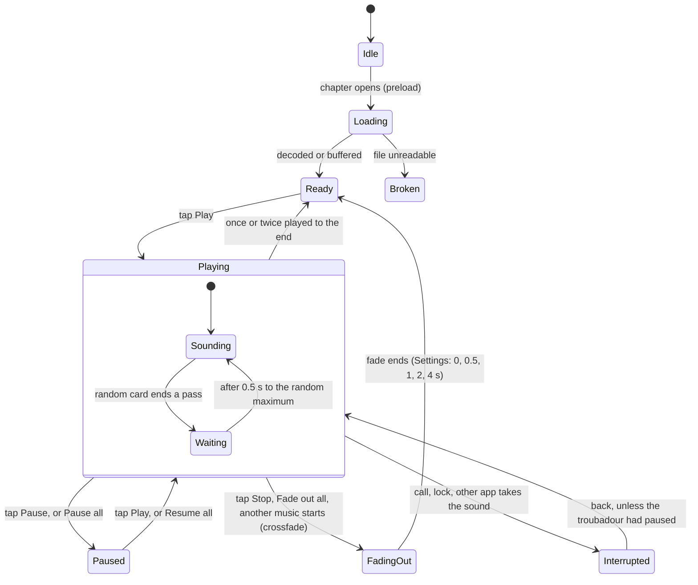
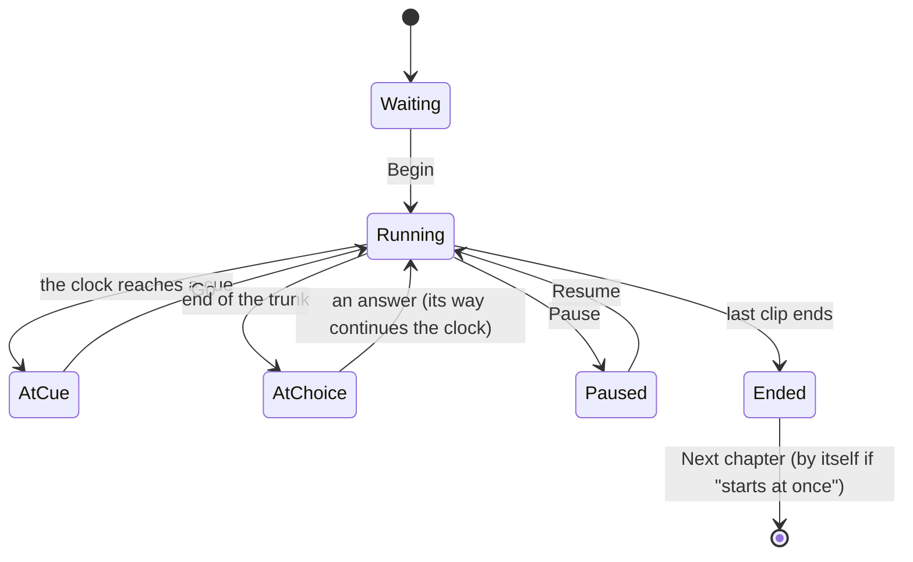
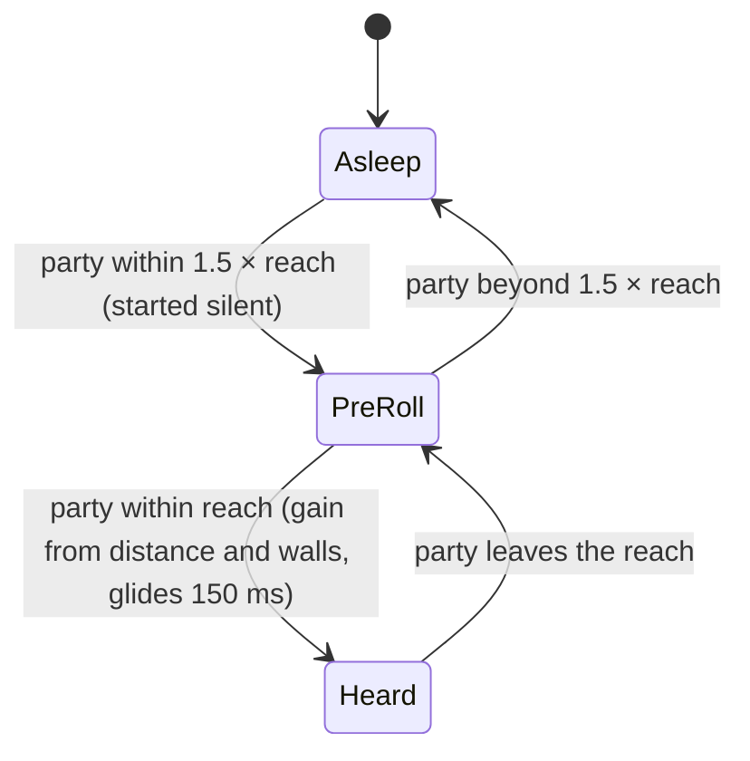

# Troubadour unifier: one logic, one look, every app, every platform

Version 1, 18 November 2026. Scope: the three apps of La Troupe (Troubadour, Troubadour Ballade, Troubadour Map) on the three platforms (website and La Troupe pages, iPhone and iPad Home Screen web apps, Android app). Sister documents: `261114_troubadour_graphic_charter.md` (the look), `261114_ballade_plan.md` and `261114_map_plan.md` (each app's own work). Branch: `unify/261118-shared-kernel`.

The question asked: which tools do teams building complex apps use to keep many screens, apps and platforms coherent, and what do they say about Troubadour today. Five were chosen, defined for Troubadour, and run against the code. Each one found real incoherences; the shared ones were fixed in code, the others are listed with the decision they need.

---

## 0. In one page

| | |
| --- | --- |
| **Tools** | 1. Ubiquitous language and bounded contexts (DDD) · 2. Design tokens (W3C DTCG 2025.10) · 3. Interface inventory and atomic design · 4. Statecharts (Harel) · 5. Platform parity matrix with the consistency heuristic (Nielsen 4) |
| **Found** | 24 incoherences (section 7): 11 fixed in this branch, 1 now guarded by a check, 12 open with a proposal |
| **Worst ones** | Ballade heard its master and soundbox sliders on a straight line while every other player squares them (same slider, about 6 dB louder at half); the soundbox volume had two names and was never shared; three copies of the context menu with three different danger styles; two forked helper files (Ballade, Map) drifting apart; Android still saying "rhythm" in 9 texts; the sound rules (limiter, even loudness, gapless trims, coming back after a call) exist in Ballade and Map but not in the Troubadour players |
| **Built** | `docs/shared/`: the token source and its builds for the web and Android, the shared kernel (settings, volume curve, theme, toast, question dialog, delivery, audio context, menu rows), shared components (context sheet, toast), the shared sound engine and install guide moved out of the app folders; a platform contract checked on every push |
| **Not touched** | Nothing a troubadour sees changes, except: Ballade's volume now matches the other apps (a bit softer at the same slider), the soundbox volume follows from app to app, danger rows in menus look the same everywhere, toasts last 2.8 s everywhere, fixed words |

---

## 1. Ubiquitous language and bounded contexts

**What it is.** From Domain-Driven Design (Eric Evans): one shared, rigorous vocabulary used the same way in the screens, the code, the file formats and the conversations, valid inside a *bounded context*. When two parts of a system need the same word to mean different things, they are different contexts and the translation between them is written down (a *context map*). A small *shared kernel* holds what every context agrees on.

**For Troubadour.** La Troupe is four contexts around one kernel:

| Context | Owns | Its words |
| --- | --- | --- |
| **Kernel** (shared by all) | a sound and its identity, its kind, its credits; the soundbox; the troubadour name; themes; settings shared between apps; the volume curve | sound, kind (music, ambiance, event), soundbox, pin, troubadour name, Forgotten Troubadour, theme, appearance |
| **Troubadour** | stories, chapters, the table | story, chapter, card, row, loop (1×, 2×, ∞, random), table, life events |
| **Ballade** | time | ballade (*.troubadour-ballade*), wire, gate, cue, choice, way, clock |
| **Map** | space | world (*.troubadour-map*), map, place, element, wall, reach, party point, way (a door to another map) |
| **La Troupe** | sharing | Recueil, tale, builder, export, revision, Discovery |

**Glossary rules found or set (the words a troubadour reads):**

| Word | Means | Never |
| --- | --- | --- |
| build | make a story, ballade or world in a builder | forge, rhythm, edit (the tool is a *builder*, not an *editor*) |
| export | make the file (*.troubadour*, *.troubadour-ballade*, *.troubadour-map*) | forge |
| share | give a tale to the Recueil | forge |
| ambiance | the teal kind, in every text | ambience (stays only as a code and file key: `ambience`, `--amb`) |
| event | the red kind | effect (except "sound effect" in the soundbox help) |
| way | Ballade: an answer's branch; Map: a sign that leads to another map | two meanings in two contexts: allowed by the context map, never mixed on one screen |
| silence (setting) | Troubadour: silence the other chapters when changing chapter | |
| silent (setting) | iPhone: play even with the silent switch on | a confusing pair: proposed label "Play with the silent switch" and key kept |

**Found:** Android said "Rhythm a story", "Tales rhythmed by other troubadours", "Rhythming the .troubadour" and 6 more (fixed: build, share, export); Map said "Forging the .troubadour-map", "Could not forge", "files you forge", "never forged yet" (fixed: export). The Android setting `forgeTip` and the Kotlin `bard` fields keep old names in code only (allowed: code is not read at the table; to rename with the next data migration).

## 2. Design tokens (W3C DTCG 2025.10)

**What it is.** A design token is one named design decision (a colour, a radius, a duration) stored once in a neutral format and *built* into each platform's own code. The W3C Design Tokens Community Group published its first stable format in October 2025 (2025.10): JSON with `$value`, `$type`, `$description`, groups, and aliases written `{group.token}`. One source, many outputs, no copy by hand.

**For Troubadour.** Before: the palettes lived three times, in `play/style.css` (web), `Theme.kt` (Android) and partly `site.css` (website) and `flow.css` (Ballade gold and silver), kept equal by hand. A check of all 14 palettes found no drift yet: good luck, not a guarantee.

Now:

```
docs/shared/troubadour.tokens.json        the one source (DTCG 2025.10)
  │  python3 .github/scripts/build_tokens.py
  ├─▶ docs/shared/tokens.css               every web page links it first
  └─▶ app/.../ui/TroubadourTokens.kt        Android's paletteOf() reads it
```

| Group | Holds | Notes |
| --- | --- | --- |
| `zone` | music, ambiance, event, blue, shadow, in dark and light | the everyday themes point to it by alias |
| `theme.<name>.<dark/light/any>` | the 13 colours of each of the 10 themes | `$extensions.com.troubadour`: label, limited edition, light or dark ground |
| `fixed` | danger, gold (and hot, glow, ink), silver and the choice portal's sheen | never themed; Pride and Excalibur gold as a listed exception |
| `radius`, `space`, `size`, `motion` | charter 5.1 to 5.3 and 7 | now usable as `--r-card`, `--sp-12`, `--sz-bar`, `--t-hover` |
| `audio` | the volume curve exponent, loudness targets, limiter, fade choices | the sound rules are design decisions too: Android reads the same numbers |

**Found while moving them:** the choice portal's silver had two sets of names (`--silver*` and `--sv-*`) that agree in dark and differ in light (`--sv-mid` is the light `--silver-hot`); now written once with aliases where they agree. The website, the Map page and the app pages did not all have the gold, silver and danger tokens: now every page has the same full set.

## 3. Interface inventory and atomic design

**What it is.** Brad Frost's interface inventory: take stock of every piece of the interface across all screens, group the same pieces together, and see how many versions of each exist. Atomic design then sorts them from atoms (a button, an icon) to molecules (a sound card) to organisms (the table, a dialog) to templates and pages, so each piece is built once and used everywhere.

**For Troubadour (web, 5 apps and the site; Android in brackets):**

| Piece | Level | Copies before | Where | Now |
| --- | --- | --- | --- | --- |
| Theme tokens | token | 3 (+1 Android) | style.css, flow.css, site.css, Theme.kt | **1**, built (2) |
| Icons (`svg()`, ICON set) | atom | 3 sets | ios/app.js, flow-ui.js, map-ui.js (+ Icons.kt) | **kernel set + app extras** for Ballade and Map; iPhone and web player next |
| Button, icon button, segmented, toggle | atom | 1 | troupe.css, style.css | already shared (the base sheets) |
| Toast | molecule | 6 functions, 4 durations (2.6, 2.8, 3.2 s) | play, ios, builder, library, flow-ui, map-ui | **one style** (components.css), **2.8 s everywhere**, one function for Ballade and Map |
| Question dialog (`ask`) | molecule | 3 | ios, flow-ui, map-ui (Map's had a second field and sizes) | **1** in the kernel for Ballade and Map (Map's superset) |
| Busy veil | molecule | 3 | ios, flow-ui, map-ui | **1** for Ballade and Map |
| Context sheet (menu of a story, tale, world) | organism | 3 CSS copies, 3 danger looks | troupe.css `.bm-`, flow.css `.fl-`, map.css `.mp-` | **1** (components.css `.t-menu`, old names kept as aliases) |
| Settings store and theme apply | logic | 5 | play, ios, troupe/settings, flow-ui, map-ui | **1** for Ballade and Map; one shared list of shared settings |
| Audio context, master, limiter | logic | 4 | play, ios, flow-ui, map-ui | **1** for Ballade and Map (with the limiter) |
| Sound card (table) | molecule | 3 | play/app.js, ios/app.js, TableScreen.kt; Map's Heard now | open: same anatomy (charter 6.2), three codes |
| Settings dialog | organism | 5 | play, ios, troupe/settings, ballade, map | open: same sections, five markups |
| Install guide (iPhone) | organism | 1, living in `ios/` | used by Ballade and Map | moved to `shared/install.js`, `shared/install.css` |
| Sound engine | logic | 1, living in `ballade/` | used by Map | moved to `shared/troubadour-engine.js` (`TroubadourEngine`) |

## 4. Statecharts

**What it is.** David Harel's statecharts (1987): state machines with nested and parallel states, drawn as boxes and arrows and executable as code (SCXML, XState). Each thing is in exactly one state, every event that matters is an arrow, and an event with no arrow is ignored on purpose. Writing the chart first makes "impossible states" visible, and the same chart can drive every platform.

**For Troubadour.** Three charts carry the logic that must feel the same everywhere. They are the reference: a new screen or platform implements these states and these arrows, no more, no fewer.

### 4.1 A sound card (Troubadour table on web, iPhone and Android; Map's Heard now; the soundbox pads)



### 4.2 A Ballade chapter (the clock decides, the wire follows)



### 4.3 A place's sounds in Map (space decides)



**What the charts found:**

| Arrow or state | Troubadour web | Troubadour iPhone | Troubadour Android | Ballade | Map |
| --- | --- | --- | --- | --- | --- |
| Interrupted → Playing (after a call or a lock) | wake lock only | on coming back to the screen | **pauses, waits for a tap** | by itself unless paused (engine guard) | by itself on the table (engine guard) |
| FadingOut length | Settings | Settings | Settings | Settings | Settings (old 1.5 and 3 s mapped to 2 and 4) |
| Playing, master change | glides | glides | glides | was **linear**, now curved | curved |
| A sound limited at the master | no | no | no (native mixer) | yes, -2 dBFS | yes, -2 dBFS |

The interruption is the clearest case: one event, three behaviours. Proposal: the Ballade and Map rule everywhere (come back by itself unless the troubadour had paused), Android included, since a game master mid-session expects the table to be as they left it.

## 5. Platform parity matrix and the consistency heuristic

**What it is.** A design matrix that crosses every feature with every platform and app, so a gap is a visible empty cell, not a surprise at the table. Each row is then judged with Jakob Nielsen's fourth heuristic, *consistency and standards*: the same word, look and behaviour inside the product family (internal), and the conventions of each platform (external: Android back button, iPhone Home Screen, a computer's keyboard).

**For Troubadour (✓ has it, · not offered on purpose, ✗ missing):**

| Feature | Site | Web player | iPhone | Android | Ballade | Map |
| --- | --- | --- | --- | --- | --- | --- |
| Themes and limited editions | · (Obsidian) | ✓ | ✓ | ✓ | ✓ | ✓ |
| Shared settings (set in one, hold in all) | · | ✓ | ✓ (own storage on iPhone) | · (own app) | ✓ | ✓ |
| Volume heard as v² | · | ✓ | ✓ | ✓ | **✓ now** (was linear) | ✓ |
| Soundbox volume shared | · | ✓ | ✓ | · | **✓ now** | **✓ now** |
| Gapless loops, encoder silence trimmed | · | ✗ | ✗ | own native loops (not measured by the lab) | ✓ engine | ✓ engine |
| Even out the loudness | · | ✗ | ✗ | ✗ | ✓ | ✓ |
| Limiter on the master | · | ✗ | ✗ | ✗ | ✓ | ✓ |
| Comes back after a call or lock | · | partly | partly | ✗ (waits) | ✓ | ✓ |
| Discovery | ✓ links | ✓ | ✓ | ✓ | ✓ | ✓ |
| Recueil | ✓ La Troupe | ✓ | ✓ | ✓ | · | · |
| Builder | · | Story builder (computer) | story editor | story editor | builder (computer, iPad) | builder (computer, iPad, phone panels) |
| Troubadour name (GitHub) | · | ✓ | ✓ | ✓ | ✓ | ✓ |
| Toast 2.8 s, one sentence | · | **✓ now** (was 3.2) | **✓ now** (was 2.6) | snackbar (to check) | ✓ | ✓ |
| Context sheet, danger row | · | **✓ now** | n/a | own sheet | **✓ now** | **✓ now** |
| Offline after install | · | · | ✓ (service worker) | ✓ | ✓ | ✓ |
| Orientation | any | landscape | landscape | landscape | portrait | landscape |

**Heuristic reading.** Internal consistency is strong in the look (one charter, now one token source) and weakest in the sound: the three Troubadour players lack the engine that Ballade and Map share, so the same tale sounds evener and cleaner in Ballade than at the Troubadour table. External consistency: Android's pause on interruption is the Android convention for media apps, which is why it differs; the proposal keeps the notification controls but restores the table as it was.

On iPhone each Home Screen web app keeps its own storage, so "set in one, it holds in all" is true in a browser on a computer and on Android Chrome, not between Home Screen apps on an iPhone. The settings texts should not promise it there.

## 6. What this branch changes

| Change | Files |
| --- | --- |
| Token source and builds | `docs/shared/troubadour.tokens.json`, `docs/shared/tokens.css`, `app/.../ui/TroubadourTokens.kt`, `.github/scripts/build_tokens.py`; `play/style.css`, `ballade/flow.css`, `site.css` lose their copies; `Theme.kt` reads the tokens |
| Shared kernel | `docs/shared/troubadour-ui.js`; `ballade/flow-ui.js` (187 lines) and `map/map-ui.js` (264 lines) become thin: their own defaults, icons and migrations only. Same API, same icons and same settings as before, checked by loading both old and new side by side |
| Volume curve | Ballade master and soundbox heard as v² like every other player (`flow-player.js`) |
| Shared settings | one list (`SHARED`) with one name per setting; the soundbox volume is shared (`sbVolume` in Ballade and Map is `sbVol` in `troubadour.settings`, as in Troubadour and Android); "Even out the loudness" and "silent switch" shared too |
| Shared components | `docs/shared/components.css`: context sheet (`.t-menu`, aliases `.bm-`, `.fl-`, `.mp-`) and toast; the three copies removed |
| Shared files out of app folders | `ballade/ballade-engine.js` → `shared/troubadour-engine.js` (global `TroubadourEngine`, `BalladeEngine` kept); `ios/install.js` → `shared/install.js`; `ballade/flow-install.css` → `shared/install.css`; pages, service workers, labs and the lab workflow follow |
| Words | Map: 4 "forge" texts; Android: 9 "rhythm" texts |
| Versions | iPhone, Ballade and Map 261118.1 (app and service worker); cache keys of the web player and La Troupe pages |
| Platform contract (CI) | `.github/scripts/check_platforms.py` and `.github/workflows/platforms.yml`, on every push and pull request; the APK build also runs on pull requests that touch the app (nothing published) |

**Checked:** the 11 pages of the site, La Troupe, the web player, iPhone, Ballade and Map, loaded in Chrome from `main` and from this branch in five looks (Obsidian dark, Parchment light, Pride, Excalibur light, Blood dark): **55 screens of 55 identical pixel for pixel**, no new script error, no theme value changed (pages only gain the tokens they lacked). In Ballade and Map: the master at 0.7 is heard at 0.49, the soundbox volume set in Troubadour is read, the toast and the danger row of a menu take the shared look. The old and new Ballade and Map helpers give the same API, the same 30 and 70 icons and the same settings. The contract was run against broken copies to see it fail. The Android build runs on the pull request (no Android SDK here).

## 7. Incoherences found

| # | Where | What | Tool | Status |
| --- | --- | --- | --- | --- |
| 1 | Ballade | master heard linear, others v²: same slider about 6 dB louder at half | 4, 5 | **fixed** |
| 2 | Ballade | soundbox volume linear | 4, 5 | **fixed** |
| 3 | settings | soundbox volume named `sbVol` and `sbVolume`, never shared | 1 | **fixed** |
| 4 | settings | "Even out the loudness" and "silent switch" not shared between Ballade and Map | 1, 5 | **fixed** |
| 5 | CSS | three copies of the context sheet, three danger looks (text only, text, tint and border) | 3 | **fixed**: charter 6.1 (text and border) |
| 6 | JS | `flow-ui.js` and `map-ui.js` forked: question dialog, focus, master curve already apart | 3 | **fixed** (kernel) |
| 7 | tokens | palettes in 4 places | 2 | **fixed** (one source, built) |
| 8 | tokens | `--silver*` and `--sv-*`: two names, different in light | 2 | **fixed** (written once) |
| 9 | toasts | 2.6, 2.8 and 3.2 s | 3, 5 | **fixed**: 2.8 s |
| 10 | words | Android "rhythm" (9), Map "forge" (4) | 1 | **fixed** |
| 11 | files | engine and install guide shared but living in `ballade/` and `ios/` | 3 | **fixed** (`shared/`) |
| 12 | offline | service worker lists kept by hand: a new shared file could be forgotten | 5 | **guarded** by the contract |
| 13 | sound | Troubadour players (web, iPhone) do not use the engine: no trims, no evening, no limiter | 4, 5 | open: P2 below |
| 14 | sound | Android native engine not measured by the sound lab | 5 | open: export its render to the lab |
| 15 | logic | interruption: three behaviours (section 4) | 4 | open: decision 1 |
| 16 | settings | iPhone Home Screen apps cannot share settings, the texts say they do | 5 | open: decision 2 |
| 17 | code | sound card written three times (web, iPhone, Android) | 3 | open: P3 |
| 18 | code | settings dialog written five times | 3 | open: P3 |
| 19 | code | iPhone `app.js` (2613 lines) and the web player keep their own toast, ask, settings, icons | 3 | open: P1 |
| 20 | words | `silence` and `silent` settings side by side on iPhone | 1 | open: relabel |
| 21 | tokens | the privacy page carries its own palette inline | 2 | open (a standalone legal page, harmless) |
| 22 | Android | `forgeTip`, `bard` names in code and stored preferences | 1 | open: rename with a migration |
| 23 | Android | no "Even out the loudness", no limiter | 5 | open: with 13 |
| 24 | parity | Ballade on Android is the browser web app; Map disabled on Android (decided) | 5 | by decision, to show plainly on the Android Library |

## 8. Rules from now on

1. **A colour, a radius, a duration or a sound number is a token.** Change `troubadour.tokens.json`, run `python3 .github/scripts/build_tokens.py`, commit the three files. The contract fails if a sheet declares a theme colour or if the builds are stale.
2. **A piece used by two apps lives in `docs/shared/`.** Never inside one app's folder, never copied.
3. **New logic starts as a statechart** (section 4 style) in the plan of the app, then becomes code; every platform implements the same states.
4. **A new feature gets a row in the parity matrix**, with a ✓, a · (not offered, and why) or a ✗ (missing, and when).
5. **A new word goes into the glossary first** (section 1).
6. **Every offline app keeps what it loads**: the contract fails otherwise. App and service worker change VERSION together.

## 9. Next steps

| Phase | Content | Done when |
| --- | --- | --- |
| **P1 Kernel everywhere** | web player and Troubadour for iPhone on `troubadour-ui.js` (toast, ask, busy, settings, theme, icons) | iPhone `app.js` loses its copies; contract still holds |
| **P2 One sound** | the web player and iPhone table play through `troubadour-engine.js`: trims, gapless seams, evening, limiter, interruption guard; Android: limiter and evening in the native mixer from the same token numbers | the sound lab runs on the Troubadour discovery stories and passes |
| **P3 One card, one settings dialog** | the sound card and the settings dialog as shared components (one markup builder, one sheet); Android mirrors them in Compose from the same tokens | one file per component on the web |
| **P4 Charts as tests** | the three statecharts written as small tables the labs walk through (each event in each state) | an impossible state fails a test |

## 10. Decisions for Arthur

1. **Interruption:** should every platform come back by itself after a call or a lock (unless the troubadour had paused), Android included? Proposed: yes.
2. **Settings on iPhone:** say in Settings, on iPhone only, that each app keeps its own settings, or drop the "set in one, holds in all" line there? Proposed: the line only where it is true.
3. **Ballade's volume:** it now sounds like the other apps, a little softer at the same slider than before (about 2 dB at 0.8). Fine as is, or raise Ballade's default master to 0.9?

## Sources

- W3C Design Tokens Community Group, Design Tokens Format Module 2025.10 (first stable version, 28 October 2025): https://www.designtokens.org/tr/2025.10/
- Brad Frost, Atomic Design, chapter 4 (interface inventory): https://atomicdesign.bradfrost.com/chapter-4/
- David Harel, Statecharts: A Visual Formalism for Complex Systems (1987); XState documentation, why state machines: https://stately.ai/docs/xstate/v6/why-state-machines
- Nielsen Norman Group, Consistency and Standards: https://www.nngroup.com/articles/consistency-and-standards/
- Eric Evans, Domain-Driven Design (2003); DDD Community glossary: https://www.dddcommunity.org/resources/ddd_terms/
