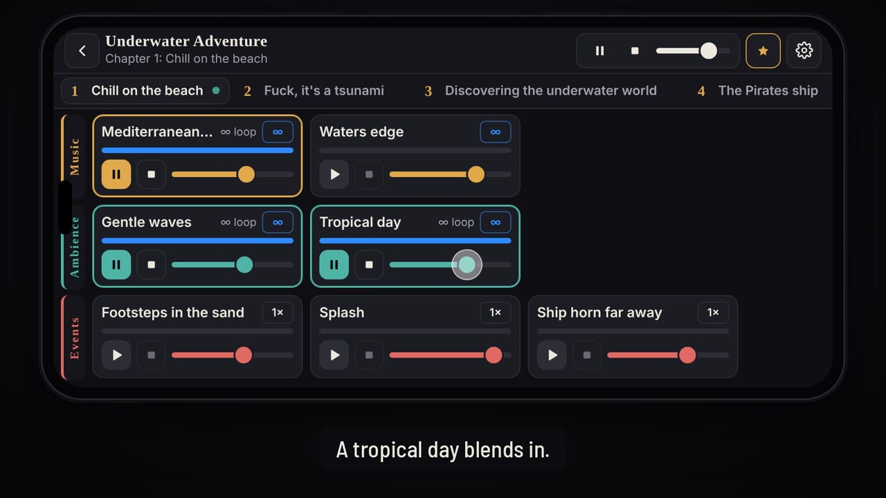

# Troubadour

Bardic is now **Troubadour**. This repository starts a fresh history from Bardic as of 21 October 2026; `.bardic` and `.bardic-flow` files open everywhere as before. Setting up GitHub Pages, the GitHub sign-in and the Android builds: [261021_troubadour_setup.md](261021_troubadour_setup.md).

Game Master Phone Sound Table: an Android app that lets tabletop RPG game masters run music, ambiances and sound effects live from their phone.

Project page: https://arthurvangeersdaele.github.io/Troubadour/

## Tutorial

[](https://arthurvangeersdaele.github.io/Troubadour/tutorial/261015_troubadour_tutorial_en.mp4)

Three minutes, subtitled, no voice over: what Troubadour is, a chapter of Underwater Adventure layered sound by sound (headphones on), how to rhythm and share a story, La Troupe, and where to get Troubadour. [Watch it in English](https://arthurvangeersdaele.github.io/Troubadour/tutorial/261015_troubadour_tutorial_en.mp4), [en français](https://arthurvangeersdaele.github.io/Troubadour/tutorial/261015_troubadour_tutorial_fr.mp4), or on the [project page](https://arthurvangeersdaele.github.io/Troubadour/#tutorial). Files, subtitles (`.srt`) and sound credits are in [`docs/tutorial/`](docs/tutorial/).

**Play it in your browser:** https://arthurvangeersdaele.github.io/Troubadour/play/ with three ready-made stories (The Forest Adventure, The Big War, Underwater Adventure), the mixing table and the soundbox. More tales, like Werewolf, are in La Troupe. No import and no story editing in the web edition; its sounds live in [`docs/play/sounds/`](docs/play/sounds/).

**On iPhone:** [Troubadour for iPhone](https://arthurvangeersdaele.github.io/Troubadour/ios/) installs from Safari on the Home Screen (Share, then Add to Home Screen). It only runs from there: opened in a browser tab it shows the install steps, and on other devices it says it is made for iPhone. The Troubadour page shows its install button only on an iPhone.

## Status

**Android beta.** The app follows Troubadour for iPhone, natively:

- **Library**: stories kept on the phone, with four ways to add one: New story, Discovery (the web edition's three stories), the Recueil, Import .troubadour.
- **Story editor**: chapters (add, rename, reorder, remove), Music / Ambiances / Events and the story's own soundbox; sounds picked from the phone or a cloud folder, or reused from another story; listen, rename, reorder, loop mode.
- **Mixing table**: the chapter on screen is loaded into the engine as soon as it opens, so its sounds start instantly. Up to 20 sounds held at once; a sound of another chapter takes the voice of an idle card. Music crossfades, green-to-red progress along the bottom edge of each card with a countdown, pause/resume all, fade out all, master volume. Events and ambiances can also be set to random: they come back after a pause of 0.5 s to a maximum set in Settings (1 to 10 s). Music cannot (one track at a time, with crossfades).
- **Soundbox**: the story's effects and the shared ones, decoded in memory and fired without taking any of the 20 voices; pins.
- **Settings**: Obsidian, Parchment, Blood and Divination in dark, light or system mode, troubadour name, fade-out length, music crossfade, keep the screen awake, storage, export every story, erase everything.
- **Playback with the screen off**: a media notification with Pause all and Fade out all; pauses on phone calls and when headphones are unplugged.
- `.troubadour` import and export (format 2), with the revision counter and the troubadour name.

The engine test screen of step 1 is still there, under Settings, About, Engine test.

## Try it on your phone

1. Open the [latest dev build](https://github.com/arthurvangeersdaele/Troubadour/releases/tag/dev-latest) on your Android phone.
2. Download the `.apk` and open it. Allow installs from your browser when Android asks.
3. Tap **Discovery** to add a ready-made story, or **New story** to build one with your own sounds, then **Play**.

Every push to `main` rebuilds the APK automatically (GitHub Actions). All builds share the same debug key, so a new build installs over the previous one. When the build fails, the compiler errors are reported as an annotation on the run.

## Architecture

| Layer | Tech |
| --- | --- |
| UI | Kotlin, Jetpack Compose, landscape only; fonts Cormorant SC and Barlow Semi Condensed (SIL OFL, `app/src/main/assets/licenses/`) |
| Storage | `filesDir/library/`: one JSON file per story, the shared soundbox, and the audio files they point to (`data/Library.kt`) |
| Audio | C++ mixer on [Oboe](https://github.com/google/oboe) (AAudio / OpenSL ES), one low-latency output stream |
| Decoding | Android NDK `AMediaExtractor` + `AMediaCodec`, streamed per voice into lock-free ring buffers |
| Target | minSdk 26 (Android 8.0), targetSdk 35 (raise to 36 before publishing on Google Play) |

Engine details (`app/src/main/cpp/audio_engine.cpp`):

- up to 20 voices mixed in a single audio callback, no allocation or locks on the audio thread;
- one decoder thread fills a 2-second ring buffer per voice, so every loaded sound is pre-decoded and starts instantly;
- loop once / twice / infinite handled at decode time for gapless loops;
- fade-out on End, smoothed volume changes (no clicks), linear resampling to the device rate;
- fade envelope per voice: fade-in for crossfades, 40 ms fade on pause (no click), resume from a fade-out;
- soundbox effects decoded fully in memory and mixed as one-shots (up to 24 at once) with their own volume;
- automatic stream reopen when the output device changes (headphones, Bluetooth).

## Web edition

`docs/play/` is a static page served by GitHub Pages (no build step):

- `stories.json`: the three stories and their chapters;
- `sounds/<story>/<chapter>/{music,ambience,events}/*.mp3` and `sounds/soundbox/*.mp3`: the audio files;
- `library.json`: the list of sound files, rebuilt automatically by the **Update sound library** action when MP3s are pushed (or by hand with `python3 .github/scripts/build_sound_library.py`).

Opening a story downloads every MP3 of every chapter into memory, so each sound starts instantly. Events and ambiances can be set to random (their loop button cycles 1×, 2×, ∞, random): they play again after a pause of 0.5 s up to the longest pause set in Settings, Random sounds (1 to 10 s), like on Android and iPhone. Themes (Obsidian, Parchment, Blood, Divination, each dark or light), fade-out length, music crossfade and screen wake lock are in Settings.

## Troubadour for iPhone

`docs/ios/` is a Home Screen web app that follows the Android plan, served by GitHub Pages (no build step):

- **Stories kept on the phone**: stories, chapters and sounds live in IndexedDB (`db.js`), sounds as blobs shared between stories, and the app asks iOS for persistent storage (Settings shows whether it is granted and how much room is left).
- **Library**: new story, import a `.troubadour` from Files, add a tale of the Recueil, or add one of the three discovery stories (downloaded once from `docs/play/`).
- **Story editor**: chapters (add, rename, reorder, remove), Music, Ambiances and Events with loop mode, order and preview per sound, the story's own soundbox, a description. Sounds come from Files or are reused from any story already on the phone.
- **Mixing table**: the same table as the web player (cards, loops, random events and ambiances, fades, crossfade, master), plus a soundbox drawer with the story's effects and the shared ones. Loop and volume changes made at the table are kept.
- **Shared soundbox**: quick effects available on every table.
- **Export**: rhythms the next revision of a story (`.troubadour` format 2, signed with the troubadour name) and opens the iOS share sheet: Files, iCloud Drive, AirDrop. Files are named `YYMMDD_story-title.troubadour`. Settings can export every story at once, as a backup.
- **Settings**: theme (Obsidian, Parchment, Blood, Divination), dark, light or system, troubadour name, fade-out, music crossfade, keep the screen awake (on by default), play with the silent switch on (on by default).
- Landscape only (portrait shows a turn-your-phone screen). `sw.js` keeps the app itself offline; bump its `VERSION` (and `VERSION` in `app.js`) when shipping a change.

iOS limits to know: audio stops when the screen locks in a Home Screen app, hence the screen kept awake; storage can only be cleared by iOS when it is not marked persistent, so exporting stories now and then is the backup.

## La Troupe des Troubadours

`docs/troupe/` is the community corner of the site:

Builder and playing your own files are for computers (the app does both on a phone); on a phone La Troupe shows the Recueil only.

- **Play a tale** (`../play/#/troubadour`): opens a `.troubadour` file from the computer, or a tale of the Recueil, on the player's mixing table.
- **Story builder** (`builder.html`): name a story and its chapters, drop MP3s into Music, Ambiances, Events and the Soundbox, and download a `.troubadour` file. Everything runs in the browser, nothing is uploaded. It can also open an existing `.troubadour` to edit it. Each zone has **From a link or YouTube** (`cropper.js`): paste a link to an audio file, or a YouTube link, listen, set the start, the end and fades, and only that part is kept (encoded as MP3 in the browser by LAME, `vendor/lame.min.js`, LGPL). An audio link is fetched by the browser, so the site hosting it must allow it (CORS); otherwise download the file and drop it in the same dialog. YouTube cannot be downloaded by a web page: the video plays in an embedded player and the builder records the tab's own sound while the chosen part plays (Chrome or Edge; share **This tab** with its audio). The scissors on each card crop a sound already in the story. Events and ambiances can be set to random here too. **Recueil sounds** (`library.js`) opens a column between the chapter and the soundbox with every sound of every tale in the Recueil, searchable by sound, tale or troubadour, with Music, Ambiances, Events and Soundbox in separate tabs: listen, then drag one onto a row of the chapter or onto the soundbox, or tap Add. Only that sound's bytes are downloaded, as an HTTP range of its tale's `.troubadour` (the tales store their sounds uncompressed); if the server ignores ranges, the tale is fetched once and the sound cut out of it. An added sound remembers its tale (`extra.recueil` in the `.troubadour`), so it can be credited. The story in progress is saved in the browser as it changes, sounds included (IndexedDB, `draft.js`): leaving the page or closing the tab never loses it, and it comes back on the next visit until **New story** clears it. Rhythming empties the builder for the next tale: to change a rhythmed tale again, open its `.troubadour` (its revision count carries on).
- **Recueil** (`recueil.html`): the shared library of `.troubadour` files stored in `docs/recueil/`. Anyone can add one through a pull request ([how](docs/recueil/README.md)); the **Recueil** action checks pull requests and, once they are merged, rebuilds `docs/recueil/index.json` (the tales) and `docs/recueil/sounds.json` (every sound of every tale, with its row and its byte range in the `.troubadour`, for the Story builder's sound library; the same audio in the same row is listed once).

The `.troubadour` format (a ZIP with `story.json` and the audio files, signed with a troubadour name and versioned by a hidden revision counter) is specified in [TROUBADOUR_FORMAT.md](TROUBADOUR_FORMAT.md). The troubadour name is set in Settings: the web player's (shared with the Story builder) and the Android app's. In the app, `app/src/main/java/com/troubadour/app/troubadour/` reads and writes the format and `settings/BardSettings.kt` keeps the troubadour name; the engine test screen can already open a `.troubadour` and export it as its next revision.

## Troubadour Ballade

`docs/ballade/` is a second app in the repo, not shown on the Troubadour page yet: https://arthurvangeersdaele.github.io/Troubadour/ballade/

Troubadour Ballade is for troubadours who prepare the exact timing of their sounds before the session, then follow it at the table. It plays vertically, on a phone held upright:

- **Library**: the stories kept on the device (IndexedDB, `flow-db.js`), Import, Settings. No Recueil, no Discovery.
- **Player**: the story title on top, the chapters in a row that scrolls sideways, then the chapter as a cascade of steps from top to bottom. A step holds up to three sounds side by side; a golden wire runs down the screen, splits to the cards of a step and joins again below, and lights each card as its moment comes, so the coming sounds are always in sight. Steps follow on their own when the one above ends; gates wait for a tap on **Go**. At the end of a chapter, the wire waits on a golden **Next chapter** button. Pause (the whole timeline stops with the audio clock), fade out everything, master volume, the story's soundbox in a drawer, tap a playing card to fade it out, tap any step to jump there.
- **Editor** (computer only for now): steps, gates, when the next step starts, and for each card its offset, length, trim, repeat, fades and volume; sounds dragged from the chapter, another chapter or the soundbox. Importing a `.troubadour` builds a first Ballade to start from. **Rhythm .troubadour-ballade** writes the file for the phone, **Export .troubadour** gives the story back without its Ballade.
- Same themes and troubadour name as Troubadour. Home Screen web app on iPhone (`sw.js` keeps it offline; bump `VERSION` there and in `app.js` when shipping a change). The Android build comes next.

- **Discovery tale**: Underwater Adventure, timed chapter by chapter (`docs/ballade/discovery/261017_underwater-adventure.troubadour-ballade`), offered in the library until it is added. Rebuilt from the web edition's sounds by `python3 .github/scripts/build_flow_discovery.py`.

The `.troubadour-ballade` format (a `.troubadour` plus `flow.json`) is specified in [TROUBADOUR_BALLADE_FORMAT.md](TROUBADOUR_BALLADE_FORMAT.md).

## Troubadour Map

`docs/map/` is a third app, in La Troupe next to the Ballade: https://arthurvangeersdaele.github.io/Troubadour/map/ (web app first; the Android version comes later).

A story becomes a **world**, its chapters become **places**, and each place is a map the troubadour draws. At the table, the troubadour drags the party's golden point across the map and hears what the party hears.

- **Library**, laid out like Troubadour's: the last opened world in a big card (its first place as the picture, Play, Edit, ⋯), the others in rows, and **Add a world** (also the + of the top bar): **New world** (blank, named, with your own sounds) or **Import** (`.troubadour` or `.troubadour-map`). Each world opens either in the **player** (`#/play/…`) or in the **editor** (`#/edit/…`), two screens of their own; the player has no way into the editor. Importing a `.troubadour` makes one empty place per chapter: its sounds wait in the sound list, nothing is preset. Add sounds also brings audio files from the device, or every sound of another `.troubadour`.
- **Draw** (`map-view.js`): walls (Shift for a straight one), elements drawn by hand (a shape that ends near its start is an area, otherwise a line, such as a river), the library of drawings (`map-stamps.js`: lake, mountains, hills, forest, tree, swamp, rocks, campfire, tower, ruins, cave, stairs, door, bridge, tent, well, altar, grave), eraser, select and move, undo, pan and zoom (wheel, pinch, Space or the hand). The panel gives a selected element its name, its sound cards (any sound of the story, several per element: loop, random or on tap, starting with the place or not, volume), its **reach** (one radius for all its cards, measured from its outline) and the place it **leads to**. A place has its own name, size and **whole-place** sounds; the wall muffle slider (share of a sound each wall takes away) is shared by the world.
- **Play** (`map-audio.js`): the map fills the screen on the left with the party's point at mid-height (the fill button brings that view back), the sounds of the whole place open beside it (the panel button hides them). Volume on the cards as in Troubadour (Settings, Player interface, per row: Hidden, Simple in 25 % steps over 2 s, or Full with a slider). Drag the point or tap the map to send the party there; **double tap** an element for its menu (in the editor, a double tap opens an element's panel). Each element's sounds play at their volume × (1 − distance / reach), full inside an area, then × (1 − muffle) for every wall crossed on the way; gains glide, no clicks. Its menu holds its cards (play, pause, volume, how much reaches the party), its reach, and **Go to** the place it leads to (the sounds of the old place fade out, the new one starts). Whole-place sounds ignore distance and walls. Pause, fade out everything, master volume.
- Same themes and troubadour name as Troubadour. Landscape only on phones and tablets, like Troubadour (upright, it asks to turn the phone); on a computer, any window. The panel slides over the map on a narrow screen. Any touch or click wakes the audio (browsers keep it off until then). Offline once opened (`sw.js`: bump `VERSION` there and in `app.js` when shipping a change).

The `.troubadour-map` format (a `.troubadour` plus `map.json`) is specified in [TROUBADOUR_MAP_FORMAT.md](TROUBADOUR_MAP_FORMAT.md).

## Icons

- `branding/`: the Troubadour icon and its pumpkin version, each with rounded corners (web, social) and as a full square (stores; Android and iOS cut their own shape). 1024 × 1024 SVG.
- Android: adaptive icon in `app/src/main/res/` (`mipmap-anydpi-v26/ic_launcher.xml`, with a monochrome layer for themed icons). The pumpkin version is ready as `@mipmap/ic_launcher_pumpkin`: point `android:icon` and `android:roundIcon` in the manifest to it to switch.
- Web: `docs/icons/` (favicon and Apple touch icon).
- Troubadour Ballade: `branding/261017_troubadour_ballade_icon.svg` (and `_square`), the Troubadour icon darkened with a golden wire splitting in two; PNGs in `docs/ballade/icons/`.
- Troubadour Map: `branding/261031_troubadour_map_icon.svg` (and `_square`), the Troubadour icon darkened with the golden point and the dotted rings of its reach; PNGs in `docs/map/icons/`.

## Build locally

Open the folder in Android Studio (it will offer to create the Gradle wrapper), or with Gradle 8.11 installed:

```
gradle assembleDebug
```

## Roadmap

- Web edition (available): play in the browser on a computer, with La Troupe (Story builder, Recueil, playing your own `.troubadour` files). On a phone, the web offers the discovery stories and the Recueil.
- Troubadour for iPhone (available): Home Screen web app with stories kept on the phone, editor, mixing table, soundboxes and `.troubadour` import and export.

1. Audio engine: 20 voices, gapless loops, fades (done, tested on a phone)
2. Android app beta: library, editor, mixing table, soundbox, settings and themes, `.troubadour` import and export, Discovery and Recueil (available)
3. Field tests at the table, fixes and polish (in progress)
4. Release on Google Play: target API 36, store listing (planned)
